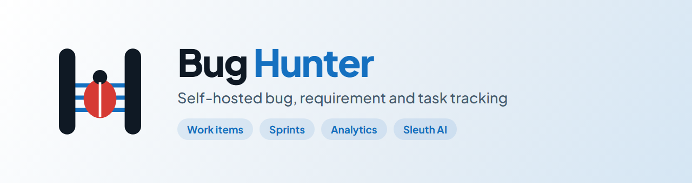
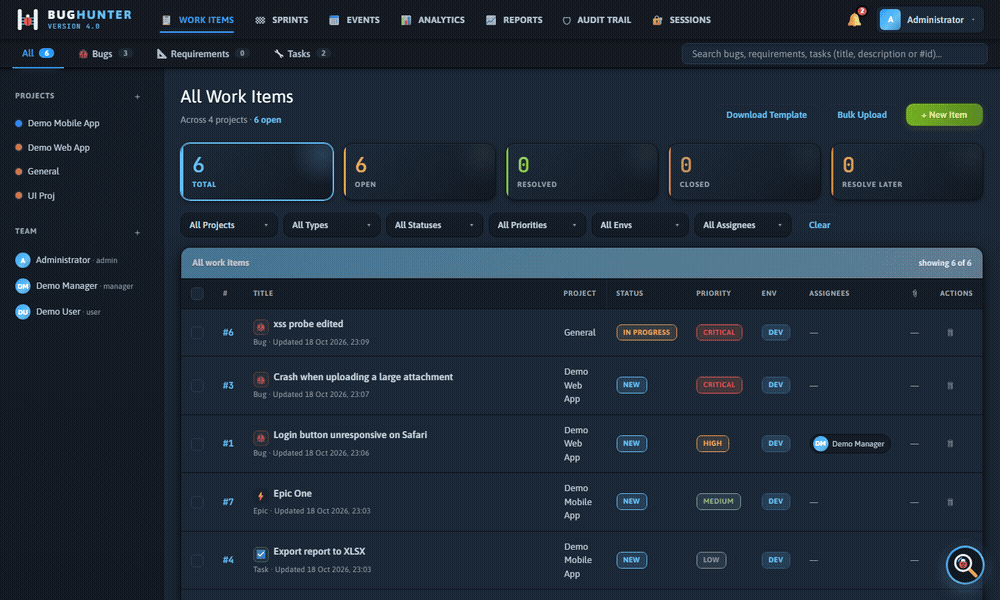
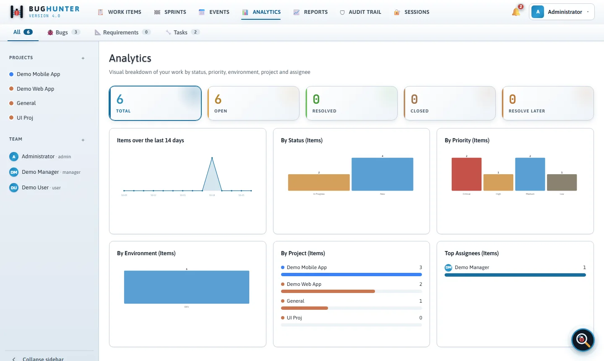
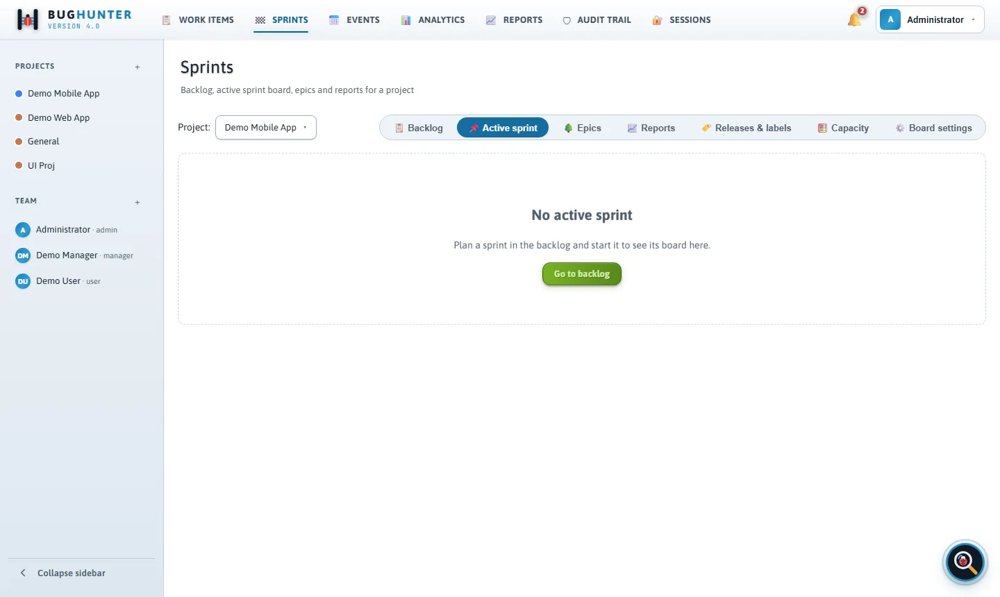
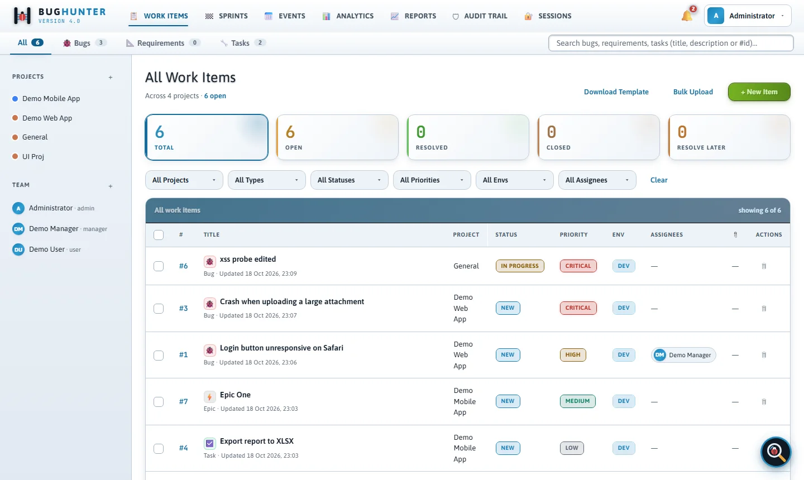
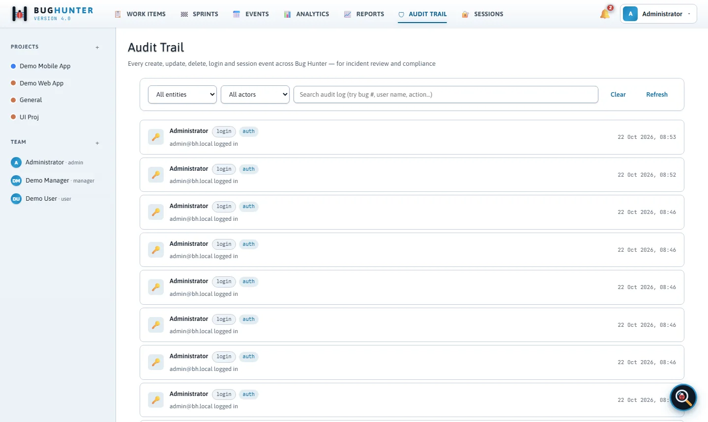
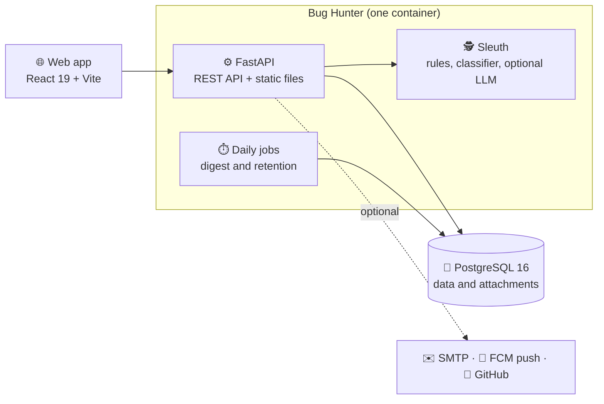
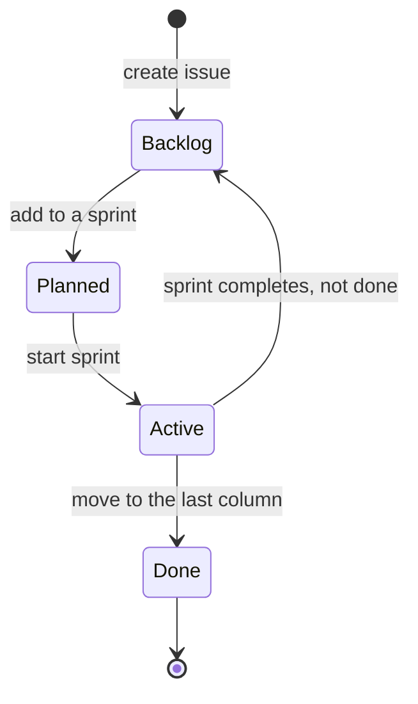
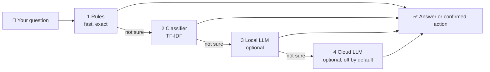
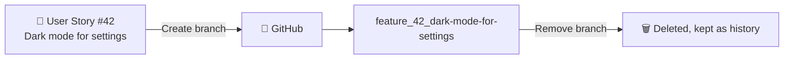

<p align="center">
  <picture>
    <source media="(prefers-color-scheme: dark)" srcset="docs/assets/banner-dark.png">
    
  </picture>
</p>

<p align="center">
  <a href="LICENSE.txt"></a>
  
  
  
  
  
  
</p>

<p align="center">
  <b>Track bugs, requirements and tasks. Plan sprints. Own your data.</b><br>
  One Docker Compose stack: FastAPI, PostgreSQL and React. No outside login service needed.
</p>

<p align="center">
  
</p>

---

## ✨ What you get

| | | |
|---|---|---|
| 🐞 **Work items**<br>Bugs, requirements, tasks, stories and epics in one list. Filters, bulk edit, Excel import. | 🏁 **Sprints & Agile**<br>Ranked backlog, sprint board, epics, burndown and velocity. | 📊 **Analytics & reports**<br>Live charts and a report builder that exports to Excel. |
| 📅 **Events**<br>Group items for a stand-up or a review. | 🔔 **Notifications**<br>In-app bell, email digest and push, each linking to the item. | 🛡️ **Audit trail & sessions**<br>See who changed what, and log out any device. |
| 🕵️ **Sleuth assistant**<br>Ask in plain English. Runs on your server by default. | 🐙 **Git branches**<br>Create a feature branch for a User Story in one click. | 🌗 **Light and dark**<br>Responsive layout that respects reduced motion. |

<details>
<summary><b>See it in light and dark</b></summary>
<br>
<p align="center">
  <picture>
    <source media="(prefers-color-scheme: dark)" srcset="docs/assets/screens/analytics-dark.webp">
    
  </picture>
  <picture>
    <source media="(prefers-color-scheme: dark)" srcset="docs/assets/screens/sprints-dark.webp">
    
  </picture>
</p>
<p align="center">
  <picture>
    <source media="(prefers-color-scheme: dark)" srcset="docs/assets/screens/list-dark.webp">
    
  </picture>
  <picture>
    <source media="(prefers-color-scheme: dark)" srcset="docs/assets/screens/audit-dark.webp">
    
  </picture>
</p>
</details>

## 🚀 Quick start

You need [Docker Desktop](https://www.docker.com/products/docker-desktop/) (Docker Engine and Compose v2).

```bash
git clone https://github.com/<your-org>/bug-hunter.git
cd bug-hunter
cp .env.example .env     # set APP_VERSION, POSTGRES_PASSWORD and BOOTSTRAP_ADMIN_* at least
./deploy.sh              # builds, starts PostgreSQL, then the app
```

Open <http://localhost:8765> and sign in with the `BOOTSTRAP_ADMIN_*` account from `.env`.
To stop: `./down.sh`. Your data stays in the `bugtracker_pgdata` volume.

> 💡 **No Docker?** Run `bash scripts/run_local.sh` (or `.\scripts\run_local.ps1` on Windows). It uses SQLite and needs no Node.
> See [Local development](docs/development.md).

## 🧭 How it fits together



One database holds everything, including attachments, so **one backup saves it all**.
More in [Architecture](docs/architecture.md).

### 👥 Roles at a glance

| Role | Can do |
|---|---|
| 👑 **Admin** | Everything: people, deletes, all projects. |
| 🧑‍💼 **Manager** | Edit any item or event, run sprints and boards. Cannot delete items or make admins. |
| 🙋 **User** | Create and edit bugs, stories and sub-tasks, move cards, view reports. |

Managers and users only see the projects they belong to.

## 🏁 Sprints, the Scrum way



Agile is off until a manager clicks **Set up Scrum board**. Nothing is changed or deleted when you do.
Details: [Sprints and Agile](docs/agile.md).

## 🕵️ Sleuth, the assistant

<p>
  <picture>
    <source media="(prefers-color-scheme: dark)" srcset="docs/assets/sleuth-dark.svg">
    
  </picture>
  Ask <i>"show open bugs assigned to alice"</i>, <i>"how many critical bugs are in PROD?"</i>
  or <i>"close bug 5"</i>. Every change asks you first and is written to the audit trail.
  By default Sleuth runs fully on your server and sends nothing out.
</p>

<br clear="left">



More in [Sleuth](docs/sleuth.md).

## 🐙 Git feature branches



Off by default. Only User Stories get branches, and only the exact branch Bug Hunter created can be removed.
Setup: [Git integration](docs/git-integration.md).

## ⚙️ Settings that matter

Everything comes from environment variables. Copy [`.env.example`](.env.example); each line is explained there.

| Setting | Default | What it does |
|---|---|---|
| `APP_VERSION` | required | Version shown in the UI and at `/api/health`. |
| `APP_ENV` | development | Set `production` to turn on strict start-up checks. |
| `SESSION_SECRET` | blank | Signs session cookies. Use a long random value in production. |
| `EMAIL_BACKEND` | `console` | `console`, `smtp` or `disabled`. |
| `OTEL_EXPORTER_OTLP_ENDPOINT` | blank | Send traces, metrics and logs to SigNoz or any OTLP collector. |
| `SLEUTH_CLOUD_ENABLED` | `0` | Opt in to a cloud LLM fallback for Sleuth. |

All settings: [Key settings](docs/environment.md).

## 🛡️ Your data stays safe

- ✅ Upgrades only **add** tables and columns. Nothing is removed or rewritten.
- ✅ `./deploy.sh` takes a database dump first, and never touches the data volume.
- ✅ `./down.sh` keeps your data. Only `./down.sh --wipe-db` deletes it, after asking.
- ✅ Passwords use bcrypt. Uploads are checked by type and content.

Read [Live-data safety and deployment](docs/upgrading.md) and the [Security model](docs/security-model.md).

## 🧪 Quality

| Layer | Tooling |
|---|---|
| Backend | `pytest` on SQLite and PostgreSQL 16, with an 80% coverage gate |
| Frontend | Vitest, ESLint, axe-core accessibility checks in light and dark |
| Browser | Playwright suites for the main journeys and phone width |
| Security | ruff, bandit, pip-audit, gitleaks, Trivy, hadolint |
| Quality gate | SonarQube, run locally with `scripts/sonar-scan.*` |

```bash
pytest -m "not ui" -n auto --cov=app      # backend
cd frontend && npm test && npm run lint   # frontend
```

All commands and CI jobs: [Testing](docs/testing.md) · [Local development](docs/development.md).

## 📚 Documentation

| Topic | Page |
|---|---|
| Every feature and role | [features.md](docs/features.md) |
| Run it with Docker | [getting-started.md](docs/getting-started.md) |
| Sprints and boards | [agile.md](docs/agile.md) |
| Key settings, email, push, telemetry | [environment.md](docs/environment.md) |
| Deploy, backup, upgrade | [operations.md](docs/operations.md) · [upgrading.md](docs/upgrading.md) |
| Sleuth and Git integration | [sleuth.md](docs/sleuth.md) · [git-integration.md](docs/git-integration.md) |
| Security model | [security-model.md](docs/security-model.md) |
| Code layout | [architecture.md](docs/architecture.md) |
| Tests, CI and performance | [testing.md](docs/testing.md) · [development.md](docs/development.md) · [performance.md](docs/performance.md) |
| Fixes for common problems | [troubleshooting.md](docs/troubleshooting.md) |

Need several teams on one install, with billing? See **Bug Hunter Enterprise**.

## 🤝 Contributing, security, license

- Contributing: see [CONTRIBUTING.md](CONTRIBUTING.md). Run the tests before you open a pull request.
- Found a vulnerability? Report it privately, see [SECURITY.md](SECURITY.md).
- License: [MIT](LICENSE.txt).

<p align="center">
  <picture>
    <source media="(prefers-color-scheme: dark)" srcset="docs/assets/logo-dark.svg">
    
  </picture>
</p>
