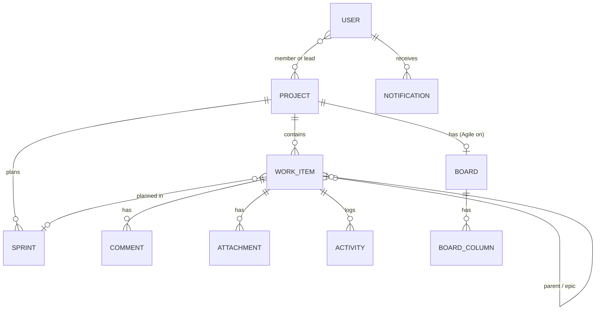

<p align="center"><picture><source media="(prefers-color-scheme: dark)" srcset="assets/logo-dark.svg"></picture></p>

# Architecture

How the code is laid out.

> [← Back to the README](../README.md)

## Data model at a glance



## Architecture

- **Backend:** FastAPI, SQLAlchemy 2.x and Pydantic 2. PostgreSQL 16 in production; SQLite for tests and quick local runs.
- **Frontend:** React 19 in plain JavaScript (JSX), built with Vite into `app/static`, which FastAPI serves directly. Tested with Vitest and linted with ESLint.
- **Packaging:** Docker Compose runs the app and its own PostgreSQL. The image is built on `python:3.12-slim`, and the frontend is compiled in a throwaway `node:22-slim` stage.
- **Sleuth:** pure-Python rules and a TF-IDF classifier, plus an optional local LLM and an optional cloud LLM with tool calling.

```
app/
├── config.py · database.py · main.py · models.py · schemas.py · telemetry.py
├── auth.py · access.py · email_service.py · notification_service.py · push_service.py
├── bulk_import.py  # spreadsheet template + row-by-row validation
├── agile/       # boards · workflow · sprints · backlog/ranking · planning
│                # hierarchy · integrity · item types · releases · taxonomy
│                # reports · permissions · idempotency · upgrade
├── git/         # branches · naming · provider · github · credentials · tls
├── routes/      # auth · users · projects · bugs · events · stats · audit
│                # sessions · reports · notifications · push · git
│                # agile · agile_board · agile_planning · agile_reports · agile_taxonomy
├── chatbot/     # Sleuth: nlu · classifier · llm · cloud_llm · redaction
│                # rag · retrieval · verify · agent · evals · tools
│                # llm_tools_agent · executor · actions · memory · excel · router
├── jobs/        # email_digest · retention (daily cleanup)
└── static/      # built React bundle + icon.png / favicon.png
frontend/        # React + Vite SPA source → builds into app/static
tests/           # SQLite-backed pytest suite (+ optional Playwright UI smoke)
scripts/         # backup/restore, load tests, release packaging, SonarQube, RAG index builder
docs/            # operations, security model, testing, performance
models/          # GGUF files for Sleuth's optional local LLM (gitignored)
```

There's no `migrations/` folder or Alembic. Schema changes are additive edits
in `app/models.py`, applied automatically and idempotently by `init_db()` on
every boot. On PostgreSQL, a database advisory lock serializes concurrent boots.
