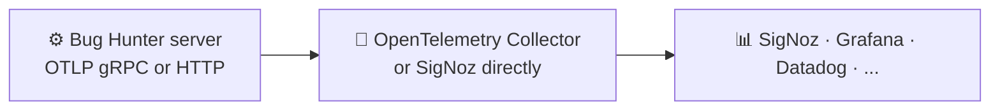

<p align="center"><picture><source media="(prefers-color-scheme: dark)" srcset="assets/logo-dark.svg"></picture></p>

# Observability: OpenTelemetry (MELT)

> [← Back to the README](../README.md)

Bug Hunter speaks **OpenTelemetry**, the open standard. It can send all four kinds of telemetry, known as **MELT**:

| | Signal | What you get |
|---|---|---|
| **M** | Metrics | HTTP server metrics and database client metrics. |
| **E** | Events | Log records with an `event.name`: every audit-trail entry, named `audit.<action>`. |
| **L** | Logs | Application logs with `trace_id` and `span_id`, so a log line links to its request. Secrets are redacted. |
| **T** | Traces | One span per request, plus database and outgoing HTTP spans. W3C `traceparent` headers let a trace continue from any client that sends them. |

**Nothing is sent by default.** Telemetry starts only when you set an endpoint, so connecting
SigNoz (or Grafana, Datadog, Honeycomb, any OTLP collector) later is a few lines in `.env`.



## Turn it on in three steps

1. **Pick your backend.** For SigNoz Cloud, copy your region's ingestion URL and your ingestion key. For a
   self-hosted SigNoz or collector, use its OTLP address (gRPC `:4317`, HTTP `:4318`).
2. **Add the settings to `.env`** (or to your platform's secret store, for example Render):

   ```bash
   # SigNoz Cloud (gRPC)
   OTEL_EXPORTER_OTLP_ENDPOINT=https://ingest.<region>.signoz.cloud:443
   OTEL_EXPORTER_OTLP_HEADERS=signoz-ingestion-key=<your-key>

   # Self-hosted collector (gRPC, no TLS inside your network)
   # OTEL_EXPORTER_OTLP_ENDPOINT=http://otel-collector:4317

   # Behind a proxy or on a platform without gRPC: use HTTP
   # OTEL_EXPORTER_OTLP_ENDPOINT=https://collector.example.com:4318
   # OTEL_EXPORTER_OTLP_PROTOCOL=http/protobuf
   ```

3. **Restart.** The log says `OTLP export enabled -> …`. Open your backend and look for the service `bug-hunter`.

To switch it all off again, remove the endpoint or set `OTEL_SDK_DISABLED=true`.

## Settings

These are the standard OpenTelemetry names, so existing OpenTelemetry knowledge applies.

| Variable | Default | Purpose |
|---|---|---|
| `OTEL_EXPORTER_OTLP_ENDPOINT` | blank (off) | Collector address. Blank means no export. |
| `OTEL_EXPORTER_OTLP_PROTOCOL` | `grpc` | `grpc` or `http/protobuf`. With HTTP the endpoint is a base URL and `/v1/<signal>` is added. |
| `OTEL_EXPORTER_OTLP_HEADERS` | blank | `key=value,key=value`, for example an ingestion key. |
| `OTEL_EXPORTER_OTLP_{TRACES,METRICS,LOGS}_ENDPOINT` / `_PROTOCOL` / `_HEADERS` | blank | Send one signal somewhere else. Any one of these also switches export on. |
| `OTEL_EXPORTER_OTLP_TIMEOUT` / `_COMPRESSION` | `10000` ms / none | Export timeout, and `gzip`. |
| `OTEL_EXPORTER_OTLP_INSECURE` | auto | Force cleartext or TLS for gRPC (default: TLS only for `https://`). |
| `OTEL_SDK_DISABLED` | `false` | `true` turns everything off, whatever else is set. |
| `OTEL_SERVICE_NAME` / `OTEL_SERVICE_VERSION` | `bug-hunter` / `APP_VERSION` | Identity in your backend. |
| `OTEL_DEPLOYMENT_ENVIRONMENT` | `APP_ENV` | Filter by environment. |
| `OTEL_RESOURCE_ATTRIBUTES` | blank | Extra `key=value` resource attributes. |
| `OTEL_TRACES_ENABLED` / `OTEL_METRICS_ENABLED` / `OTEL_LOGS_ENABLED` | `true` | Switch one signal off. |
| `OTEL_TRACES_SAMPLER` / `OTEL_TRACES_SAMPLER_ARG` | `parentbased_always_on` / `1.0` | Sampling, for example `parentbased_traceidratio` with `0.1`. |
| `OTEL_METRICS_EXPORT_INTERVAL_MS` | `60000` | How often metrics are sent. |
| `OTEL_LOG_MIN_LEVEL` / `OTEL_LOG_EXCLUDE_LOGGERS` / `OTEL_LOG_REDACT_SENSITIVE` | `INFO` / access logs / `true` | Log export filters and redaction. |
| `OTEL_TRACES_EXCLUDED_URLS` | `/api/health,/static` | Requests kept out of traces. |
| `OTEL_INSTRUMENT_SQLALCHEMY` / `OTEL_INSTRUMENT_HTTPX` | `true` | Database and outgoing HTTP spans. |

Docker Compose passes all of these through from `.env`. Every line is also explained in [`.env.example`](../.env.example).

Each running process also reports `service.instance.id` and `host.name`, so replicas can be told apart.

## Troubleshooting

- **No data?** Check, in order: the start-up log says `OTLP export enabled -> …`, `OTEL_SDK_DISABLED` is not `true`, the signal switch
  is not `false`, the sampler is not `always_off`, and your backend filter includes `OTEL_DEPLOYMENT_ENVIRONMENT`.
- **gRPC fails behind a proxy:** use `OTEL_EXPORTER_OTLP_PROTOCOL=http/protobuf` with the `:4318` address.
- **Auth errors:** check `OTEL_EXPORTER_OTLP_HEADERS` (for SigNoz Cloud: `signoz-ingestion-key=<key>`).
- Telemetry problems never stop the app. Setup errors are logged and the app carries on with console logs.
